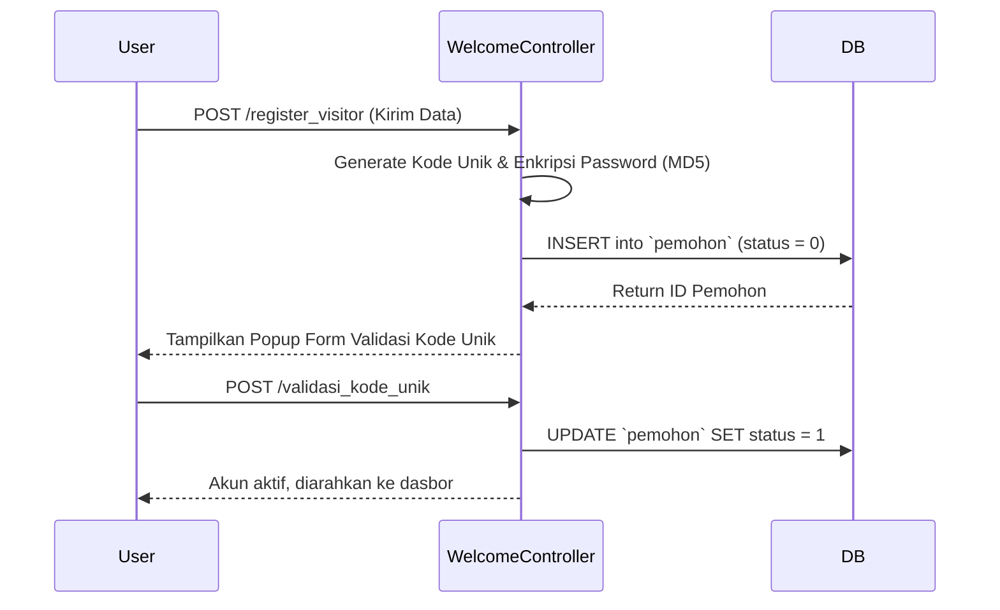

# Dokumentasi Spesifik Per Fitur

Dokumen ini membedah fitur-fitur utama di dalam aplikasi e-PPID, menjelaskan alur sistem dari hulu ke hilir untuk membantu mempermudah proses penelusuran (debugging) atau pengembangan lebih lanjut.

---

## 1. Registrasi Akun Pemohon & Login
**Tujuan**: Memungkinkan masyarakat (Pemohon) untuk mendaftarkan diri sebelum dapat mengajukan permohonan informasi, sekaligus melakukan verifikasi identitas dasar.

**Endpoint / Route**:
- `GET /daftar` (Menampilkan halaman form gabungan registrasi & login)
- `POST /register_visitor` (Menerima input form registrasi dan menyimpan ke tabel `pemohon`)
- `POST /validasi_kode_unik` (Validasi kode unik pendaftaran)
- `POST /login` (Proses otentikasi *hybrid* via guard Admin dan Guard Pemohon)

**Alur Logika (Flow)**:


**Dependency**: 
- Model: `Pemohon` (Guard Authentication: `pemohon`).
- Plugin Frontend: jQuery AJAX untuk mencegah reload halaman saat mengeksekusi form registrasi.

**Exception/Error**:
- *Duplicate Entry*: Jika pengguna mendaftar dengan email yang sama, database akan menolak query.
- *Kode Unik Mismatch*: Mereturn `{status: false}` ke _frontend_ dan jQuery akan memunculkan peringatan SweetAlert.

---

## 2. Pengajuan Permohonan Informasi (Pemohon)
**Tujuan**: Modul utama bagi masyarakat untuk mengirimkan formulir permintaan dokumen atau informasi kepada lembaga terkait.

**Endpoint / Route**:
- `GET /user` (Dasbor utama pemohon, menampilkan riwayat)
- `POST /user/ajukan_permohonan` (Endpoint pengiriman data teks & bukti KTP/Akta)
- `GET /user/print/{id}` (Mencetak bukti resi registrasi)

**Alur Logika (Flow)**:
1. Pengguna melengkapi *form* pengajuan (termasuk tujuan dan rincian dokumen).
2. Sistem memvalidasi dokumen KTP/Akta yang diunggah.
3. File dipindah (move) ke direktori `public/upload/KTP` atau `public/upload/Akta`.
4. Baris data baru masuk ke tabel `informasi_permohonan` dengan kolom `status` diisi *default* `'OPEN'`.
5. (Opsional) Notifikasi WhatsApp atau Email dikirimkan ke Admin dan Pemohon.

**Dependency**: 
- Sesi aktif Guard `pemohon`.
- Modul *File Storage* native / direktori publik yang *writable*.

**Exception/Error**:
- *Error Upload (Path)*: Terjadi jika folder target unggahan tidak ditemukan atau izin (_permission_) folder ditolak oleh web server.
- Sistem akan membatalkan *query insert* jika pemindahan (_move uploaded file_) mengalami kegagalan.

---

## 3. Manajemen Permohonan & Penanggapan Berkas (Admin)
**Tujuan**: Panel kendali interaktif (Grid DataTables) untuk Admin dalam menelaah berkas masuk masyarakat dan membalasnya (memberikan tanggapan akhir).

**Endpoint / Route**:
- `GET /admin/view_permohonan` (Menyajikan kerangka UI Tabel Permohonan)
- `GET /admin/listdatapemohon` (API Endpoint yang menyuplai JSON Server-Side Processing ke DataTables)
- `POST /admin/form_editView_permohonan` (Memuat tampilan Form HTML modal secara AJAX)
- `POST /admin/tanggapan` (Menyimpan keputusan akhir admin)

**Alur Logika (Flow)**:
```mermaid
flowchart TD
    A[Buka Dasbor Permohonan] --> B[DataTables memanggil /admin/listdatapemohon]
    B --> C[Data JSON Tampil di Grid]
    C --> D{Admin Klik Tombol 'Tanggapi'}
    D --> E[Sistem me-render modal tanggapan via POST AJAX]
    E --> F[Admin unggah Surat Balasan & setel status (APPROVE / REJECT)]
    F --> G[Sistem simpan file ke public/file/]
    G --> H[Sistem merekam baris ke tabel balasan]
    H --> I[UPDATE tabel informasi_permohonan SET status final]
```

**Dependency**:
- Sesi aktif Guard `web`.
- Tabel `informasi_permohonan` di-join ke tabel `pemohon` (untuk mengirim email balasan otomatis).

**Exception/Error**:
- *QueryException (Strict Mode)*: Jika `GROUP BY` pada kueri DataTables (seperti *listdatapemohon* dan *listakunpemohon*) memuat kolom yang salah atau tidak lengkap, DataTables akan terhenti dan mengembalikan _Ajax Error (TN/7)_. Ini ditangani dengan mendefinisikan kolom *SELECT* secara eksplisit (`created_at`, `ktp`, dll).

---

## 4. Master Data & Pengaturan CMS Publik (Admin)
**Tujuan**: Memungkinkan Admin mengubah konten halaman beranda/publik (seperti Maklumat, Regulasi, Informasi Publik, Profil, dll) tanpa memerlukan campur tangan teknisi atau merubah *source code*.

**Endpoint / Route (Siklus CRUD Standar)**:
- `GET /admin/pengaturan/informasi_publik` (Menampilkan seluruh daftar pengaturan CMS)
- `POST /admin/crud_informasi_publik` (Endpoint penyimpanan / pembaruan data)
- `GET /admin/hapus_informasi_publik/{id}` (Penghapusan data)

**Alur Logika (Flow)**:
1. Halaman admin melangsungkan permintaan ke kueri spesifik (misal `DB::table('informasi')`).
2. Proses penyimpanan (*simpan*) akan merekam URL atau menaruh dokumen file `.pdf` / `.jpg` fisik ke `public/upload/Informasi` (atau subdirektori terkait).
3. Data dilempar ke basis data.
4. Sistem mengarahkan balik pengguna ke halaman semula menggunakan fungsi bawaan `redirect()->back()`.

**Dependency**:
- Rute-rute *Resource* atau rute kustom.
- Ketergantungan relasional antar tabel (Misalnya, tabel `informasi` yang bertumpu pada `menu_id` dan `kategori_id`).

**Exception/Error**:
- *Foreign Key Constraint*: Upaya *hard-delete* (menghapus kategori secara permanen) berpotensi memunculkan masalah Constraint SQL apabila data kategori itu dipakai oleh tabel informasi. Oleh karena itu, logika yang digunakan dari struktur asal (CI3) adalah _Soft Delete_, di mana kolom `status` diubah menjadi `1` (yang menandakan data telah terhapus dari sudut pandang logika aplikasi).
