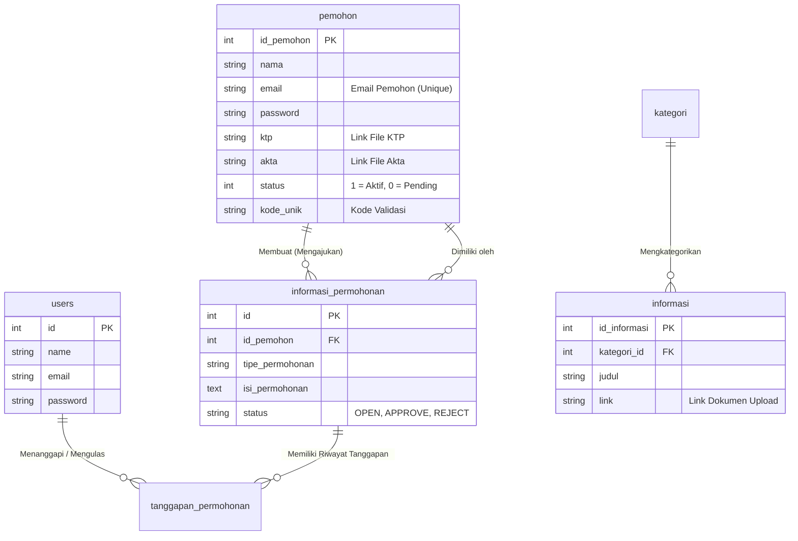

# Dokumentasi Teknis (Untuk Maintenance & Pengembangan Lanjutan)

Dokumen ini disusun secara khusus untuk memandu para pengembang (developer), staf IT, atau Database Administrator di masa mendatang. Panduan pemeliharaan (*maintenance*) ini berisiko tinggi jika salah dikonfigurasi, karenanya sangat disarankan untuk memahami skema di bawah ini sebelum mengeksekusi pembaruan skala besar.

---

## 1. Database Schema & Entity Relationship Diagram (ERD)

Aplikasi ini menggunakan perpaduan tabel dari rancangan lama CI3 yang disesuaikan struktur relasinya dengan standar modern Laravel.

### Tabel Inti (Core Tables)


**Penjelasan Relasi**:
- **Pemohon (1) &rarr; Informasi Permohonan (Many)**: Seorang pemohon (`pemohon`) dapat membuat banyak pengajuan permohonan (`informasi_permohonan`). Relasi ditarik melalui *foreign key* `id_pemohon`.
- **Kategori (1) &rarr; Informasi (Many)**: Menu CMS (misal: "Berkala", "Serta Merta") adalah _parent_ (`kategori`) yang membawahi puluhan _child_ data (`informasi`).
- **Pemisahan Pengguna**: Data Admin disimpan terpisah di tabel `users`. Data rakyat/masyarakat murni tersimpan di tabel `pemohon`.

---

## 2. Konfigurasi Environment (`.env`)

File `.env` berisi *secret key* dan kredensial sensitif. File ini mutlak tidak boleh di-*commit* ke repositori Git (publik). Berikut ini adalah *environment variable* yang WAJIB diisi dengan benar agar aplikasi dapat berjalan (terhubung):

```ini
APP_NAME="e-PPID"
APP_ENV=local           # Ubah menjadi "production" ketika dirilis (live)
APP_KEY=                # (Wajib) Di-generate menggunakan "php artisan key:generate"
APP_DEBUG=true          # Ubah ke "false" pada server production demi keamanan
APP_URL=http://e-ppidv2.test # (Wajib) Domain/URL web

LOG_CHANNEL=stack
LOG_DEPRECATIONS_CHANNEL=null
LOG_LEVEL=debug

DB_CONNECTION=mysql     # Driver (tetap mysql/mariadb)
DB_HOST=127.0.0.1       # (Wajib) IP Server Database
DB_PORT=3306            # (Wajib) Port Database (biasanya 3306)
DB_DATABASE=ptgaramc_ppid # (Wajib) Nama Database yang berisi skema
DB_USERNAME=root        # (Wajib) Nama pengguna database
DB_PASSWORD=            # Password pengguna database (kosong di Laragon/XAMPP)

SESSION_DRIVER=file     # Cara Laravel melacak data login pengguna (web & pemohon)
```

**Catatan Maintenance**: 
Jika sistem mendadak gagal menghubungkan diri ke basis data dan menampilkan pesan error HTTP 500 (`PDOException`), selalu cek kembali `DB_DATABASE` dan `DB_USERNAME` pada `.env`.

---

## 3. Daftar Library / Package External

Di bawah ini adalah daftar pustaka (*library/package*) pihak ketiga yang sangat fundamental perannya dalam memastikan aplikasi e-PPID ini beroperasi. Tidak ada modul berlebihan yang kami pasang selain yang diwajibkan untuk menjalankan warisan komponen UI dari kerangka CI3 yang lama.

### A. Library Backend (Komponen Laravel)
Murni menggunakan pustaka internal yang ditawarkan instalasi standar Laravel 12 (seperti `illuminate/database` untuk _Eloquent Builder_ dan `illuminate/auth` untuk sistem otentikasi multi-guard). Tidak ada plugin eksternal PHP kustom yang dipasang demi memaksimalkan kinerja sistem dan meminimalisir masalah kompatibilitas di masa depan.

### B. Plugin Frontend (Assets)
Kerangka aplikasi ini sangat bergantung pada jQuery. File aset fisiknya diletakkan dalam subdirektori `public/assets_user/plugins/` serta dipanggil di master layout `gabungan.blade.php`.

1. **AdminLTE (v3)**
   - *Alasan*: Bertanggung jawab menangani struktur kerangka (Grid, Sidebar interaktif, Navbar) antarmuka Admin dan User. UI legendaris ini tetap dipertahankan karena perombakan akan memaksa Admin sistem beradaptasi dari nol.
2. **jQuery (AJAX)**
   - *Alasan*: Nyawa dari aplikasi hybrid ini. Sebagian besar fitur (Registrasi Pemohon, Pengajuan Formulir, hingga klik tombol Tanggapan Admin) tidak memuat ulang halaman (_page-reload_), melainkan dioperasikan di belakang layar menggunakan kueri jQuery `$.ajax()`.
3. **DataTables (Vanilla JS)**
   - *Alasan*: Digunakan pada Dasbor untuk mencetak ratusan ribuan rekapitulasi secara *Server-Side Processing* dengan integrasi pencarian cepat. (*Perhatian: Fitur ini tidak bergantung pada plugin "yajra/laravel-datatables", melainkan DataTables jQuery asli yang merender respons berformat JSON murni dari Controller Laravel*).
4. **SweetAlert2**
   - *Alasan*: Untuk mencetak *popup* notifikasi yang rapi (seperti "Gagal Daftar!" atau "Permohonan Berhasil Dikirim") menggantikan JS `.alert()` standar.
5. **Select2**
   - *Alasan*: Digunakan agar fitur *Dropdown* di menu dasbor dapat mencari data (Searchable Dropdown) yang elegan (cth: menu *Dropdown* Tahun Pemohon).
6. **Chart.js**
   - *Alasan*: Membantu menyusun visualisasi interaktif. Grafik lingkaran (Pie/Donut) di halaman beranda / dasbor yang mendeskripsikan persentase *Approval* (Disetujui/Ditolak) digambar menggunakan data yang disuplai lewat endpoint API JSON khusus grafik.
